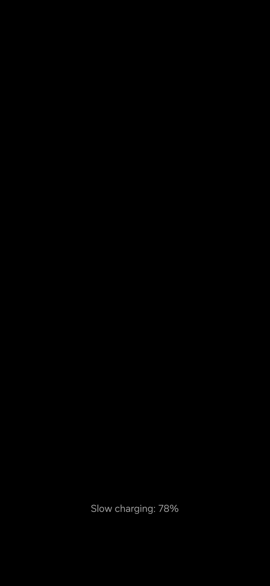

# 🪙 Pocket Ledger

> **Your money, in focus.** A sleek, modern, and private personal finance manager built natively for Android with Kotlin and Jetpack Compose.

---

## 👥 Credits & Collaboration

- **Product Vision, Ideas & Direction:** [a-ti-k](https://github.com/a-ti-k)
- **Engineering, Architecture & Implementation:** AI Assistant (Android Studio Development Expert)

---

## 📱 App Preview

---

## ✨ Key Features

- **Dashboard & Financial Summary:** Get a clear overview of your monthly spending, remaining budget, total income, and net savings at a glance.
- **Transaction Management:** Seamlessly add, edit, and delete income and expense entries with amount, date, category, payment method, notes, and priority labels (*Mandatory*, *Non-mandatory*, *Needs review*).
- **Category Tracking:** Organize expenses across pre-defined categories (*Food & Dining, Groceries, Housing, Utilities, Transportation, Healthcare, Shopping, Entertainment, Subscriptions, Travel, Other*) with dedicated history views.
- **Budget Planning:** Set monthly spending targets and monitor progress with real-time percentage indicators.
- **Dark Mode Support:** Fully responsive light and dark themes tailored with custom Material 3 color palettes.
- **Privacy First:** All data is securely stored locally using app-private preferences. **No account login, cloud sync, or network permissions required.**

---

## 🛠️ Tech Stack & Architecture

- **UI Framework:** [Jetpack Compose](https://developer.android.com/jetpack/compose) with [Material 3](https://m3.material.io/) design principles.
- **Language:** [Kotlin 2.0.21](https://kotlinlang.org/)
- **Build System:** Android Gradle Plugin (AGP) 8.7.3 with Java 17 compatibility.
- **Target Platform:** Android SDK 35 (Min SDK 26).

---

## 🚀 Getting Started & Build

1. Open this project root folder in **Android Studio**.
2. Allow Gradle sync to complete.
3. Connect an Android device with USB debugging enabled (or start an emulator).
4. Click **Run** to build and install the application.

---

## 📄 License

This project is open-source and available under the MIT License.
